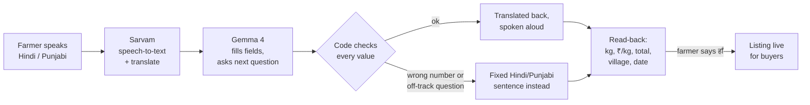

<div align="center">

# समृद्धि · Samriddhi

**A voice-first marketplace that lets small farmers in Punjab sell straight to city kitchens, by speaking in Hindi or Punjabi.**

[**Live prototype →**](https://getsamriddhi.vercel.app) &nbsp;·&nbsp; [How we used Claude](docs/HOW_WE_USED_CLAUDE.md) &nbsp;·&nbsp; Arthakram Rapid Prototyping Hackathon, Problem Statement 4: *The Farm-to-Fork Gap*

</div>

---

## The problem

A farmer near Ludhiana sells tomatoes for a fraction of what a restaurant in the city pays. The gap goes to a chain of middlemen, and the farmer has no way to reach buyers directly: every app is a form, and most forms are in English.

The brief had a catch with two halves:

1. **The farmer cannot read English** (and may struggle to read at all). A translated form is not enough.
2. **Middlemen do real work**: transport, storage, credit. Cutting them out breaks the chain.

## Our answer

| The catch | What Samriddhi does |
|---|---|
| Can't read | The farmer **speaks** the listing. The app asks for anything missing, **reads it all back aloud**, and goes live only after the farmer says "हाँ". Sales are **heard**, not just shown. |
| Middlemen matter | They become **paid pickup partners**: a fixed ₹4/kg fee, shown openly in every price, with their own run sheet of pickups, times and earnings. |

## Try it

| Who | Link | What to do |
|---|---|---|
| 👩‍🌾 Farmer (phone) | [/farmer?farmer=f3](https://getsamriddhi.vercel.app/farmer?farmer=f3) | Tap the mic, say *"सौ किलो गाजर, अठारह रुपये किलो, गाँव दाखा, परसों पिकअप"*, then confirm. |
| 🍽️ Buyer (laptop) | [/buyer](https://getsamriddhi.vercel.app/buyer) | Pick a listing, see the per-kg price split, order. The farmer hears it. |
| 🚚 Pickup partner | [/partner](https://getsamriddhi.vercel.app/partner) | See the day's run: villages, arrival times, km, earnings. Reject a pickup to pass it on. |

Demo farmers: `f1` Ramesh (Dakha), `f2` Sunita (Sahnewal), `f3` Mohan Lal (Doraha) speak Hindi; `f4` Gurpreet (Mullanpur), `f5` Harjit (Jagraon) speak Punjabi. Switch language any time with हिंदी / ਪੰਜਾਬੀ.

## How a listing is made



**The AI talks; code guards the facts.** That one rule shapes the whole product:

- **Every number the farmer hears is checked** against what they said. Numbers and village names are masked before translation and restored after, so the translator can't change them. If anything doesn't match, the farmer hears a fixed, pre-written sentence instead.
- **The read-back is always our own sentence**, never free AI text: kg, price, total, village and pickup date.
- **Every AI question must ask for the next empty field.** A reply that wanders ("which other crop?") is replaced with the fixed question.
- **The farmer's own words win.** Crop, village and relative dates (कल, परसों) are read from the original Hindi/Punjabi, because translation garbles them (दाखा once became "Dhaka").
- **A spoken "yes" only counts** if nothing changed since the farmer heard the read-back.
- If the AI is down, a rule-based parser takes over and the flow keeps working.

## Price split

Every listing shows the buyer exactly where each rupee goes. The split is frozen on the order when it is placed.

| Per kg | Example |
|---|---|
| Farmer's asking price | ₹16.00 |
| + Pickup partner (the re-roled middleman) | ₹4.00 |
| + Spoilage buffer | ₹3.00 |
| + Platform fee (6%, rounded to ₹0.50) | ₹1.50 |
| **= Buyer pays** | **₹24.50** |

*Fees are our assumptions for the pilot, labelled as such in the app.*

## Features

**Farmer** — voice listing in Hindi or Punjabi · 50 crops (vegetables, fruits, grains, pulses) with checked Hindi and Punjabi names · tap any field to re-speak it · type instead of speak · hear each sale · call the pickup partner in one tap · delete a listing (asked aloud, in Hindi, before it goes).

**Buyer** — live board of listings · transparent per-kg split · stock that can't be oversold · "Your orders" list with the newest order highlighted.

**Pickup partner** — run sheet by date and village · estimated arrival time and drive distance for each farm, nearest village first · earnings from the fee frozen on each order · reject a pickup and it goes to the next partner.

## Tech stack

| Layer | Choice |
|---|---|
| App | Next.js 16 (App Router), React 19, TypeScript, Tailwind CSS v4 |
| Speech & translation | [Sarvam AI](https://www.sarvam.ai): Saaras v4 speech-to-text, Sarvam-Translate, Bulbul v4 text-to-speech |
| Understanding the farmer | Gemma 4 (31B) on [Ollama Cloud](https://ollama.com) |
| Data | Upstash Redis (in-memory store when no keys are set) |
| Hosting | Vercel |
| UI | Lucide icons, Motion, Three.js, components adapted from Aceternity UI; Anek, Mukta and Noto Sans Gurmukhi fonts |
| Tests | Vitest — 119 tests over pricing, fact-checks, parsing, dates, crops, orders and routes |

## Run it locally

```bash
git clone https://github.com/zeniqen/samriddhi.git
cd samriddhi
npm install
cp .env.example .env.local   # then fill in the keys below
npm run dev                   # http://localhost:3000
```

| Variable | Needed for |
|---|---|
| `SARVAM_API_KEY` | Speech-to-text, translation, text-to-speech |
| `OLLAMA_API_KEY` | The AI conversation (without it, the rule-based parser is used) |
| `OLLAMA_BASE_URL`, `OLLAMA_MODEL` | Defaults: `https://ollama.com`, `gemma4:31b` |
| `UPSTASH_REDIS_REST_URL`, `UPSTASH_REDIS_REST_TOKEN` | Shared storage. Leave empty locally to use the in-memory store. |
| `SARVAM_TTS_MODEL` | Default `bulbul:v4-flash` |

The mic needs HTTPS or `localhost`.

```bash
npm test        # 119 unit tests
npm run lint
npm run build
```

## Project structure

```
app/
  farmer/  buyer/  partner/       the three screens
  api/turn                         one conversation step: speech → fields → spoken reply
  api/speak                        text-to-speech
  api/listings  api/orders         marketplace (+ DELETE a listing)
  api/notifications                sale confirmations for the farmer
  api/partner                      run sheet (+ reject a pickup)
lib/
  conversation.ts  llm.ts          the AI turn and its prompt
  factcheck.ts  localize.ts        number checks, masked translation
  reply-guard.ts                   keeps AI questions on the next empty field
  crops.ts  validate.ts            crop catalogue, field validation
  fallback-parser.ts               works when the AI doesn't
  pricing.ts  orders.ts            price split, overselling lock
  pickup.ts  geo.ts                partner routes, times, distances
  store.ts                         Redis / in-memory storage
components/                        ListingCard, MicButton, PriceSplit, ui/
tests/                             Vitest suites
```

## What's real and what's simplified

**Real:** the voice pipeline in Hindi and Punjabi, the AI conversation, every fact-check, live listings and orders in Redis, overselling protection, frozen price splits.

**Simplified for the prototype:**
- No login: the farmer is chosen by link (`?farmer=f1`), on purpose for shared phones.
- No real payments, SMS or WhatsApp; confirmations are spoken in the app.
- Fictional farmers, buyers and one pickup partner (placeholder phone number).
- Rejecting a pickup flags it; the hand-off to a second partner is described, not built.
- Times and distances are estimates from approximate village locations, not maps.
- Fees are assumptions; Ludhiana-area villages only; no produce quality checks.

## Built with Claude

We built Samriddhi with Claude Code, from reading the brief to the deployed app: test-first code, an independent code review, live debugging from production logs, and scored design critiques. The app's own AI is Sarvam and Gemma, not Claude. Full write-up: [docs/HOW_WE_USED_CLAUDE.md](docs/HOW_WE_USED_CLAUDE.md).

---

<div align="center"><sub>Every person and business in the demo data is fictional. Village names are real places in Ludhiana district.</sub></div>
